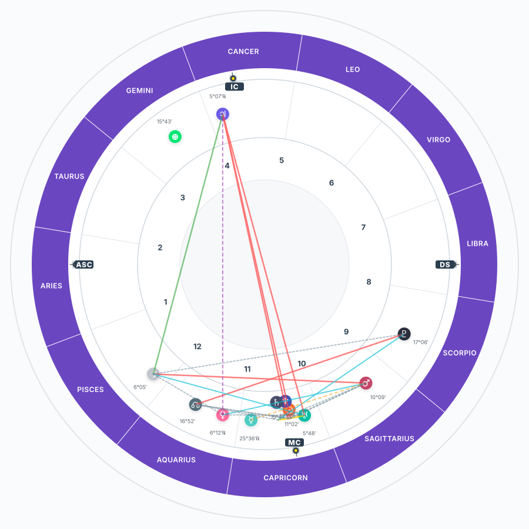
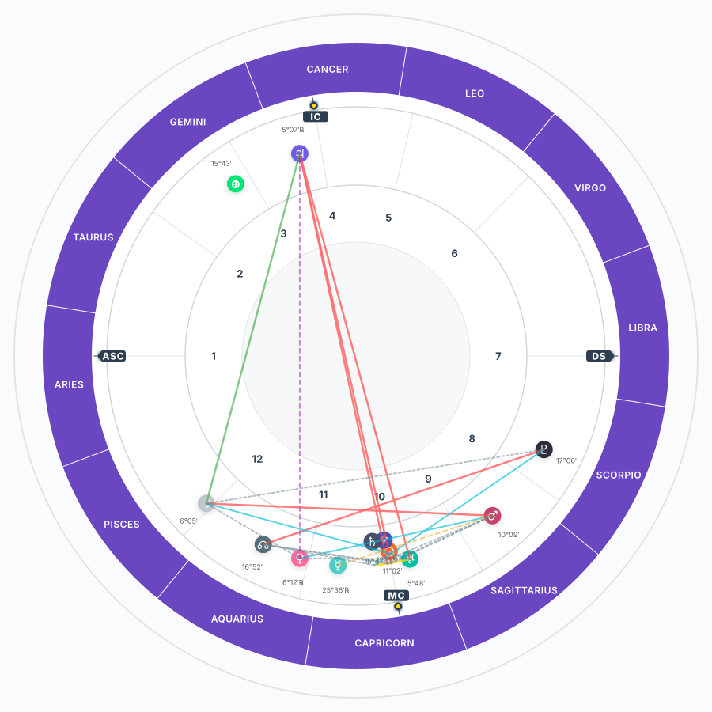
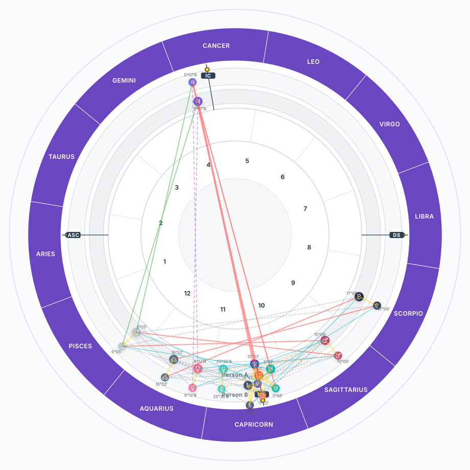

# Starluck Epoch API

> *FastAPI service for astrological charts & visuals — created by the Starluck team*

A powerful, modern API that computes natal data, renders beautiful SVG chart wheels, performs synastry calculations, and generates insightful astrological reports.

## Chart Examples

| **Whole Sign Chart** | **Placidus Chart** | **Synastry Biwheel** |
|:---:|:---:|:---:|
|  |  |  |

## Features

- **Natal Charts** — Complete birth chart calculations with planets, houses, angles & aspects
- **SVG Chart Wheels** — Beautiful single and biwheel visualizations  
- **Synastry & Composite** — Relationship compatibility analysis
- **Transit Forecasts** — Future planetary influences and timing
- **Markdown Reports** — Clean, readable astrological interpretations

## Complete Setup Guide

### Requirements

- Python 3.11 is recommended. The pinned dependencies include compiled packages;
  Python versions without compatible wheels may require native build tools.
- Git, if you are cloning the repository.
- A modern browser for the optional chart viewer.

### 1. Get the project

Clone the repository or open your existing project folder, then change to its
root directory (the directory containing `README.md` and `requirements.txt`):

```bash
git clone https://github.com/BerkePalamutcu/starluck-epoch.git
cd starluck-epoch
```

### 2. Create an isolated Python environment

Use the commands for your operating system. On Windows, create the environment
with the Python 3.11 launcher so it uses the intended interpreter:

**Windows PowerShell**

```powershell
$venv = ".\.venv"
py -3.11 -m venv $venv
$py = (Resolve-Path "$venv\Scripts\python.exe").Path
& $py -m pip install --upgrade pip
& $py -m pip install -r requirements.txt -r requirements.test.txt
```

If `py -3.11` is unavailable, install Python 3.11 and enable the Python
launcher, or use its full interpreter path in place of `py -3.11`.
If `.venv` already exists and was created with another Python version, create a
new environment with a different name rather than using that old environment.
For example, set `$venv = ".\.venv311"` above. PowerShell variables are local
to one terminal window; in each new window, set `$venv` to the environment you
created, then set `$py` with
`$py = (Resolve-Path "$venv\Scripts\python.exe").Path`.

**macOS / Linux**

```bash
python3.11 -m venv .venv
source .venv/bin/activate
python -m pip install --upgrade pip
python -m pip install -r requirements.txt -r requirements.test.txt
```

`requirements.txt` installs the API. `requirements.test.txt` adds the HTTP
client and dotenv package used by the endpoint smoke-test script. Confirm the
installation by importing the main dependencies:

```powershell
# Windows PowerShell
$venv = ".\.venv" # Use .\.venv311 if that is the environment you created.
$py = (Resolve-Path "$venv\Scripts\python.exe").Path
& $py -c "import fastapi, uvicorn, pydantic, swisseph, ephem, requests; print('Dependencies OK')"
```

```bash
# macOS / Linux (with the environment activated)
python -c "import fastapi, uvicorn, pydantic, swisseph, ephem, requests; print('Dependencies OK')"
```

### 3. Configure the API

The API reads settings from environment variables prefixed with `STARLUCK_`.
For local use, create a `.env` file in the project root. The following
configuration allows both common local viewer addresses and keeps API-key
authentication disabled:

```env
STARLUCK_ALLOWED_HOSTS=["127.0.0.1","localhost"]
STARLUCK_CORS_ORIGINS=["http://localhost:5500","http://127.0.0.1:5500"]
STARLUCK_ENABLE_API_KEY_AUTH=false
STARLUCK_API_KEY=
STARLUCK_ENABLE_DEBUG_OUTPUTS=false
STARLUCK_SWE_PATH=
```

The host and CORS settings are lists and must be written as JSON arrays in
`.env` or when set as environment variables. Do not use comma-separated values
for these settings: Pydantic Settings parses list environment values as JSON.
The default server address is `127.0.0.1:8000`; the viewer uses that address by
default. Swiss Ephemeris data files are optional.

To turn on API-key authentication, set a private key and enable the setting:

```env
STARLUCK_ENABLE_API_KEY_AUTH=true
STARLUCK_API_KEY=replace-with-your-own-secret
```

Enter the same key in the viewer's **API key** field. Do not commit a real key
or other secrets to source control.

### 4. Start the API

From the project root, run:

```powershell
# Windows PowerShell
$venv = ".\.venv" # Use .\.venv311 if that is the environment you created.
$py = (Resolve-Path "$venv\Scripts\python.exe").Path
& $py -m uvicorn app.main:app --reload --host 127.0.0.1 --port 8000
```

```bash
# macOS / Linux (with the environment activated)
python -m uvicorn app.main:app --reload --host 127.0.0.1 --port 8000
```

Keep this terminal open. A successful start includes `Application startup
complete.` Check the health endpoint at <http://127.0.0.1:8000/api/v1/health>;
it should return JSON with `"status":"healthy"`. Interactive API documentation
is available at <http://127.0.0.1:8000/docs>.

### 5. Start the browser chart viewer (optional)

Open a second terminal at the project root and start a static web server:

```powershell
# Windows PowerShell
$venv = ".\.venv" # Use .\.venv311 if that is the environment you created.
$py = (Resolve-Path "$venv\Scripts\python.exe").Path
& $py -m http.server 5500 --bind 127.0.0.1
```

```bash
# macOS / Linux (with the environment activated)
python -m http.server 5500 --bind 127.0.0.1
```

Open <http://localhost:5500> in a browser. Do not open `index.html` directly
with a `file://` URL; browsers commonly block API requests from local files.
The viewer starts with Person A's chart details and supports the chart wheel,
data, report, and transit forecast. Select **Add Person B** to reveal the
biwheel, synastry, and composite comparison features.

If the page cannot reach the API, check that the API terminal is still running
and that `.env` includes the exact viewer origin in `STARLUCK_CORS_ORIGINS`.
For example, `http://localhost:5500` and `http://127.0.0.1:5500` are different
origins and must each be listed if you use both.

Generated results have download buttons for SVG/PNG chart images, CSV tables,
raw chart JSON, TXT/Markdown reports, and TXT/CSV/Markdown forecast or
comparison data.

### 6. Run the endpoint smoke test (optional)

With the API running, open a third terminal at the project root. The test
script exercises the health, natal, SVG, biwheel, synastry, composite, report,
and forecast endpoints. It writes its output files to `debug_outputs/`.

```powershell
# Windows PowerShell
$venv = ".\.venv" # Use .\.venv311 if that is the environment you created.
$py = (Resolve-Path "$venv\Scripts\python.exe").Path
& $py app\tests\api_test.py
```

```bash
# macOS / Linux (with the environment activated)
python app/tests/api_test.py
```

If API-key authentication is enabled, set `STARLUCK_API_KEY` and
`STARLUCK_ENABLE_API_KEY_AUTH=true` in the environment or `.env` before running
the script. The default smoke-test URL is `http://localhost:8000/api/v1`.

### Troubleshooting

- **`py -3.11` is not recognized:** install Python 3.11 and its Windows
  launcher, or invoke the Python 3.11 executable by its full path.
- **The virtual environment uses the wrong Python:** recreate `.venv` with the
  desired interpreter and verify it with `& $py --version` (Windows) or
  `python --version` (macOS/Linux).
- **Native package build errors:** use Python 3.11 and upgrade pip in the
  environment. Older package pins may not provide wheels for newer Python
  releases.
- **Settings error parsing `cors_origins` or `allowed_hosts`:** use JSON-array
  values as shown above, for example
  `STARLUCK_CORS_ORIGINS=["http://localhost:5500"]`.
- **Browser CORS or connection error:** make sure both servers are running,
  use `http://localhost:5500` rather than `file://`, and allow the exact page
  origin in `STARLUCK_CORS_ORIGINS`.
- **401 response:** API-key authentication is enabled; enter the configured
  `STARLUCK_API_KEY` in the viewer.

---

## API Reference

All endpoints are available under `/api/v1`. Include `Authorization: Bearer <key>` header if using API key authentication.

### Natal Chart
`POST /api/v1/natal`

Calculate a complete birth chart with planets, houses, and aspects.

<details>
<summary><strong>Request & Response Details</strong></summary>

**Request:**
```json
{
  "datetime_local": "1990-01-01 12:00",
  "timezone": "America/New_York",
  "location": {
    "lat": 40.7128,
    "lon": -74.0060,
    "elevation_m": 10
  },
  "house_system": "PLACIDUS"  // Options: "PLACIDUS", "WHOLE"
}
```

**Response:**
```json
{
  "angles": {
    "ASC": 23.4,
    "MC": 15.1,
    "DS": 203.4,
    "IC": 195.1
  },
  "houses": [23.4, 45.1, 67.8, ...],
  "planets": {
    "Sun": {
      "lon": 280.1,
      "deg": 10.1,
      "retro": false
    },
    "Moon": { ... }
  },
  "aspects": [
    {
      "p1": "Sun",
      "p2": "Moon",
      "aspect": "trine",
      "orb": 2.1
    }
  ]
}
```
</details>

---

### SVG Chart Wheel
`POST /api/v1/svg`

Generate a beautiful single-wheel SVG chart visualization.

<details>
<summary><strong>Request & Response Details</strong></summary>

**Request:**
```json
{
  "chart_data": { /* natal chart output */ },
  "size": 900,
  "show_aspects": true
}
```

**Response:**
```json
{
  "svg_content": "<svg width='900' height='900'>...</svg>",
  "size": 900
}
```
</details>

---

### Synastry Biwheel
`POST /api/v1/biwheel`

Create a synastry comparison chart with inner and outer wheels.

<details>
<summary><strong>Request & Response Details</strong></summary>

**Request:**
```json
{
  "inner_chart": { /* natal chart A */ },
  "outer_chart": { /* natal chart B */ },
  "size": 920,
  "label_inner": "Person A",
  "label_outer": "Person B",
  "show_aspects": true
}
```

**Response:**
```json
{
  "svg_content": "<svg width='920' height='920'>...</svg>",
  "size": 920
}
```
</details>

---

### Synastry Analysis
`POST /api/v1/synastry`

Calculate inter-chart aspects between two people (no SVG output).

<details>
<summary><strong>Request & Response Details</strong></summary>

**Request:**
```json
{
  "chart_a": { /* natal chart A */ },
  "chart_b": { /* natal chart B */ }
}
```

**Response:**
```json
{
  "interaspects": [
    {
      "p1": "Sun",
      "p2": "Moon",
      "aspect": "trine",
      "orb": 1.9
    }
  ]
}
```
</details>

---

### Composite Chart
`POST /api/v1/composite`

Generate a midpoint composite chart for relationship analysis.

<details>
<summary><strong>Request & Response Details</strong></summary>

**Request:**
```json
{
  "chart_a": { /* natal chart A */ },
  "chart_b": { /* natal chart B */ }
}
```

**Response:**
```json
{
  "midpoints": {
    "Sun": { "lon": 123.4 },
    "Moon": { "lon": 67.8 }
  }
}
```
</details>

---

### Chart Report
`POST /api/v1/report`

Generate a readable Markdown interpretation of a natal chart.

<details>
<summary><strong>Request & Response Details</strong></summary>

**Request:**
```json
{
  "chart_data": { /* natal chart output */ },
  "title": "Birth Chart Analysis"
}
```

**Response:**
```json
{
  "report_content": "# Birth Chart Analysis\n\n## Sun in Capricorn\n..."
}
```
</details>

---

### Transit Forecast
`POST /api/v1/forecast`

Calculate upcoming transit aspects to natal planets within a time window.

<details>
<summary><strong>Request & Response Details</strong></summary>

**Request:**
```json
{
  "natal_chart": { /* natal chart data */ },
  "start_date": "2025-09-18",
  "timezone": "America/New_York",
  "days": 7,
  "step_hours": 12
}
```

**Response:**
```json
{
  "transits": [
    {
      "when_utc": "2025-09-18T06:40:00Z",
      "transit": "Sun",
      "natal": "Mercury",
      "aspect": "trine",
      "orb_diff": 0.01
    }
  ]
}
```
</details>

---

## Technical Notes

- **Zero Dependencies**: Works out of the box without external Swiss Ephemeris files
- **Optional Enhancement**: Set `STARLUCK_SWE_PATH` to use external ephemeris data when available
- **High Accuracy**: Precise astronomical calculations for professional use
- **Modern Stack**: Built with FastAPI, offering automatic API documentation at `/docs`

## License

This project is licensed under the **AGPL License**. Free to use with some dependencies also under AGPL licensing.

## Contributing

Please Read Contributor License Agreement before doing any contribution.

---

© MythLabs Team
